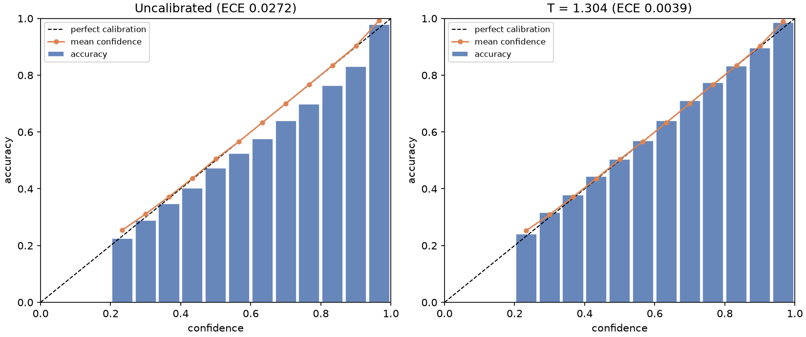
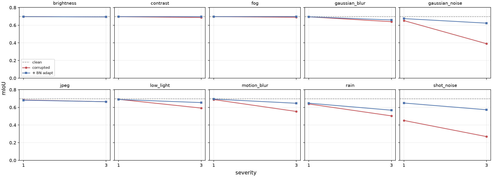
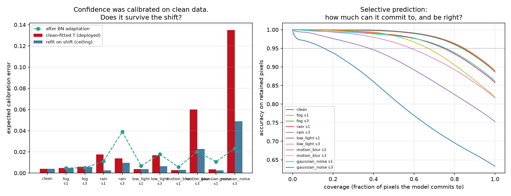
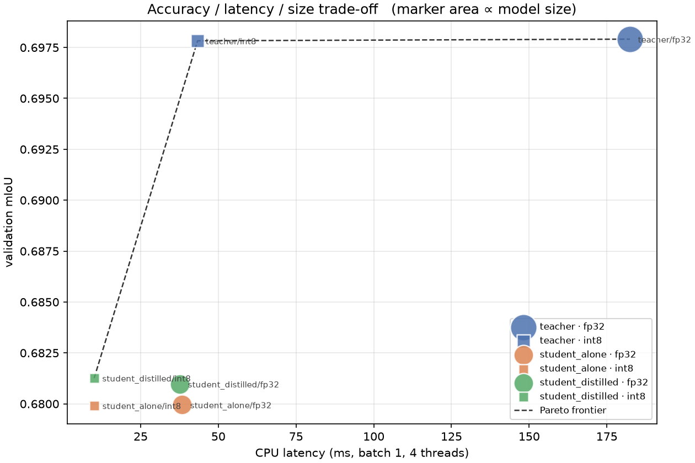
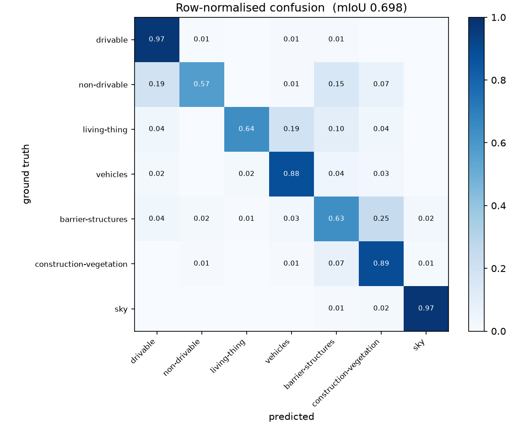
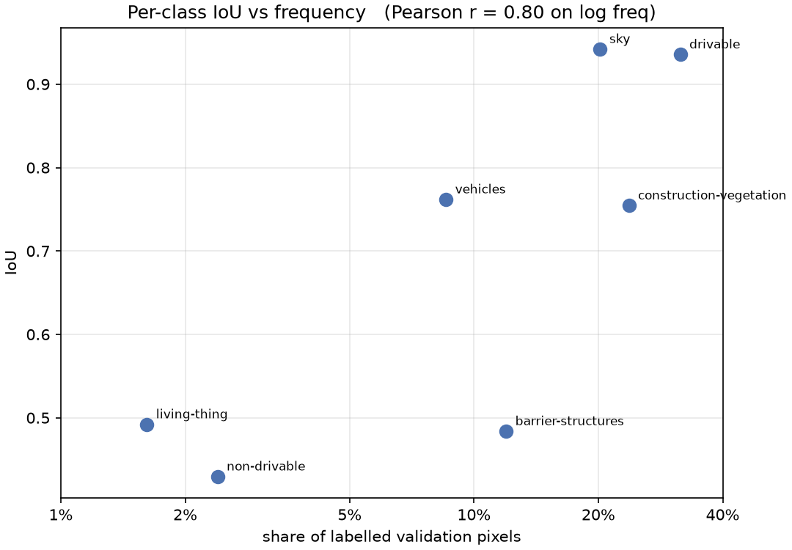
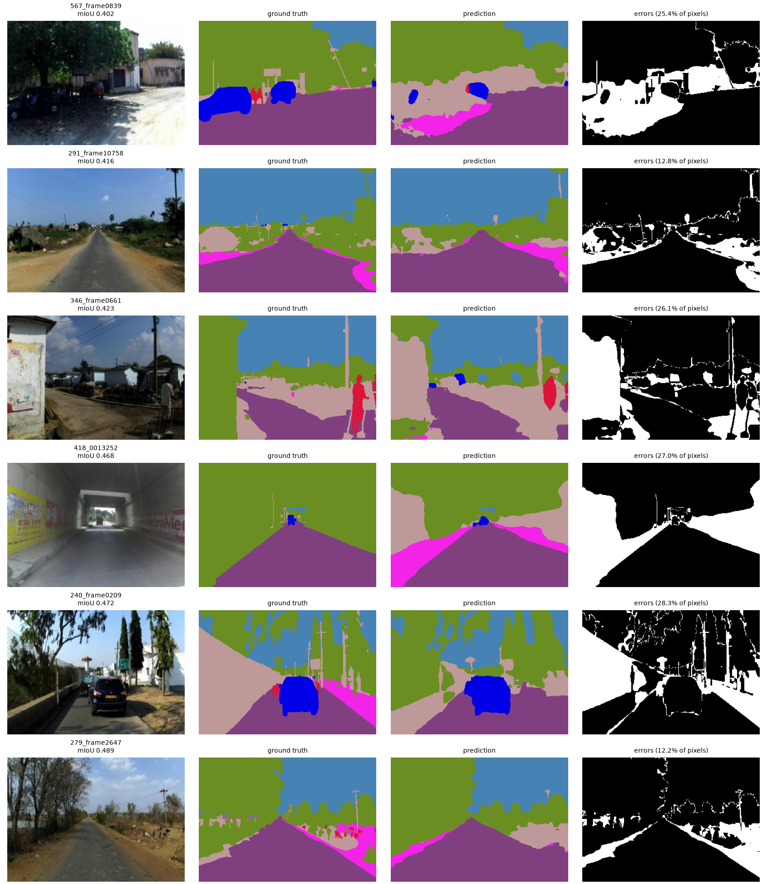

# Results

*Generated by `scripts/build_results.py` from the CSVs and JSON reports in `results/`.
Do not edit by hand.*

**Task.** 7-class semantic segmentation of unstructured Indian road scenes, using IDD's
own level-1 label hierarchy: `drivable`, `non-drivable`, `living-thing`, `vehicles`,
`barrier-structures`, `construction-vegetation`, `sky`.

**Data.** IDD Lite (`idd20k_lite`) — 1607 labelled frames across 370 drive sequences, at 320×227, trained at 320×224. Every dataset in this project
comes from IDD; there are no external data sources and no synthetic labels.

**Scale, stated plainly.** All results are at IDD Lite scale on a single M1 Pro (MPS).
This is a small dataset and the absolute mIoU values reflect that. The comparisons are
controlled — one factor varies at a time, with everything else held fixed — so the
*differences* between rows carry the meaning, within the noise §1c measures.

Runs recorded: 26, 23 of them with uncommitted changes at run time (their
git SHA does not fully identify the code that ran). Report built at `989ff64`.

---
## 1. Does a random split overstate generalization?

IDD groups frames into drive sequences — one folder per drive. Frames from the same
drive were captured on the same road in the same conditions, so they are correlated.
Splitting frames at random puts related frames on both sides of the train/val
boundary.

Measured on this dataset, a random frame split puts **94.6% of validation frames in a drive that also appears in training** (1607 frames across 370 drives). Each row below trains the identical model, schedule, augmentation and seed; only the split differs.

| split | mIoU | mean acc | pixel acc | best epoch |
|---|---|---|---|---|
| IDD's own split (drive-disjoint) | 0.6913 | 0.7889 | 0.8867 | 27 |
| Held-out drive sequences | 0.6755 | 0.7690 | 0.8866 | 27 |
| Random frame split — **leaky control** | 0.6894 | 0.7817 | 0.8954 | 30 |

**Measured inflation, one seed per arm: +0.0139 mIoU (+2.1%).** §1b repeats both arms across seeds.

Only `sequence` and `frame` are compared: both re-split the same pooled frames (242 and 241 validation frames), so the split rule is the only difference. `official` validates on IDD's own 204 frames, a different set, so it is listed for reference only.

**The inflation is real but small next to the contamination rate.** 94.6% of validation frames sharing a drive with training moved mIoU by 0.014. Frames within an IDD drive sit a median of 4,227 frame indices apart, and only 0.4% of consecutive gaps are within 30 frames, so they share scene and lighting without being near-duplicates. *Contaminated is not the same as duplicated* — which is why this had to be measured rather than assumed.

For reference, IDD's own split scores 0.6913.

---

## 1b. Is that difference bigger than seed noise?

Section 1 compares one seed per split. Here both arms are retrained across seeds;
everything but the seed and the split rule is fixed. All seeds train on the same
split (built once, with split seed 0), so this samples training noise, not the
variation from which drives land in validation.

| split | seeds | mean mIoU | std | min | max |
|---|---|---|---|---|---|
| sequence | 3 | 0.6768 | 0.0032 | 0.6734 | 0.6799 |
| frame | 3 | 0.6894 | 0.0009 | 0.6887 | 0.6904 |

Mean inflation from the leaky split: **+0.0126 mIoU** (Welch's t = 6.48, p = 0.016) — **the leakage effect is statistically resolved**.

The two arms' spreads differ (0.0009 for `frame`, 0.0032 for `sequence`), but with 3 and 3 seeds that difference is not distinguishable from chance (F-test on the variance ratio, p = 0.13). It is an observation, not a finding.

---

## 1c. How far apart are identical runs?

MPS offers no determinism guarantee (`cudnn.deterministic` is CUDA-only), so runs
with the same configuration *and* seed still disagree. Several suites repeat a
configuration exactly; within each group below, every logged setting matches.

| data | model | loss | seed | runs | mIoU range |
|---|---|---|---|---|---|
| level1_official | deeplabv3plus/resnet34 | ce | 0 | 4 | 0.0022 |
| level1_sequence | deeplabv3plus/resnet34 | ce | 0 | 2 | 0.0020 |
| level1_frame | deeplabv3plus/resnet34 | ce | 0 | 2 | 0.0007 |

Per-class IoU is far noisier than mIoU. Across the 4 identical baseline runs on IDD's own split:

| class | min | max | range |
|---|---|---|---|
| barrier-structures | 0.4747 | 0.4823 | 0.0076 |
| construction-vegetation | 0.7558 | 0.7599 | 0.0041 |
| drivable | 0.9346 | 0.9382 | 0.0035 |
| living-thing | 0.4888 | 0.5033 | 0.0145 |
| non-drivable | 0.4482 | 0.4594 | 0.0112 |
| sky | 0.9426 | 0.9432 | 0.0007 |
| vehicles | 0.7598 | 0.7660 | 0.0062 |

A single-seed difference inside these ranges is unresolved. §3b marks which
per-class changes clear them.

---

## 2. Loss ablation

IDD Lite is genuinely imbalanced — `living-thing` is 1.31% of training pixels and `non-drivable` 2.19%, against `construction-vegetation` at 26%. Plain cross-entropy optimises a pixel-weighted objective and can afford to neglect the rare classes, so the region and boundary losses have something real to fix.

Held fixed across all arms: architecture, encoder, schedule, augmentation, split, seed.

| loss | mIoU | mean acc | pixel acc | best epoch | train s |
|---|---|---|---|---|---|
| ce | 0.6903 | 0.7869 | 0.8863 | 24 | 1,870 |
| weighted_ce | 0.6921 | 0.8268 | 0.8827 | 30 | 1,872 |
| dice | 0.6962 | 0.8001 | 0.8853 | 29 | 1,998 |
| tversky | 0.6938 | 0.8070 | 0.8844 | 30 | 2,003 |
| boundary | 0.6913 | 0.7936 | 0.8862 | 24 | 1,849 |

Per-class IoU — this is where the losses actually differ:

| loss | barrier-structures | construction-vegetation | drivable | living-thing | non-drivable | sky | vehicles |
|---|---|---|---|---|---|---|---|
| ce | 0.481 | 0.758 | 0.936 | 0.489 | 0.459 | 0.943 | 0.766 |
| weighted_ce | 0.494 | 0.752 | 0.935 | 0.500 | 0.465 | 0.942 | 0.756 |
| dice | 0.489 | 0.753 | 0.935 | 0.534 | 0.457 | 0.941 | 0.763 |
| tversky | 0.484 | 0.755 | 0.936 | 0.532 | 0.450 | 0.942 | 0.758 |
| boundary | 0.487 | 0.758 | 0.937 | 0.504 | 0.448 | 0.944 | 0.762 |

**Highest: `dice` at 0.6962 mIoU (+0.0058 against cross-entropy, one seed each).**

One methodological note worth stating: in *multiclass single-label* segmentation,
Tversky's asymmetry is much weaker than in the binary case, because every false
negative for one class is simultaneously a false positive for another, so the
`alpha`/`beta` effects partly cancel. This was verified against hand-computed values
in `tests/test_losses.py`.

---

## 3. Architecture comparison

Same encoder family, loss, schedule and split; only the decoder differs. Parameter
count and training time are reported alongside accuracy because a portfolio number
that ignores cost is not a decision.

| model | decoder | encoder | mIoU | params | train s |
|---|---|---|---|---|---|
| deeplabv3plus_resnet34_s0 | deeplabv3plus | resnet34 | 0.6892 | 22,438,999 | 1,837 |
| unet_resnet34_s0 | unet | resnet34 | 0.6976 | 24,437,239 | 1,831 |
| fpn_resnet34_s0 | fpn | resnet34 | 0.6931 | 23,156,167 | 1,711 |
| deeplabv3plus_mobilenet_v2_s0 | deeplabv3plus | mobilenet_v2 | 0.6752 | 4,380,055 | 961 |

---

## 3b. Stride, not scarcity

Section 9 finds per-class IoU tracks a class's *boundary share* far better than its
rarity — pointing at thin structures lost to downsampling rather than at class
imbalance. This halves the encoder's output stride, doubling the resolution of the
features the decoder sees and changing nothing else.

Overall mIoU 0.6902 → **0.6979** (+0.0077), against an identical-run mIoU range of 0.0022 (§1c).

| class | boundary share | IoU @ stride 16 | IoU @ stride 8 | Δ | identical-run range | outside it? |
|---|---|---|---|---|---|---|
| living-thing | 54.5% | 0.5033 | 0.5217 | +0.0184 | 0.0145 | yes |
| non-drivable | 39.8% | 0.4575 | 0.4401 | -0.0174 | 0.0112 | yes |
| barrier-structures | 35.5% | 0.4775 | 0.5032 | +0.0257 | 0.0076 | yes |
| vehicles | 22.2% | 0.7598 | 0.7741 | +0.0143 | 0.0062 | yes |
| construction-vegetation | 19.3% | 0.7558 | 0.7662 | +0.0104 | 0.0041 | yes |
| sky | 11.8% | 0.9430 | 0.9440 | +0.0010 | 0.0007 | yes |
| drivable | 6.6% | 0.9346 | 0.9361 | +0.0015 | 0.0035 | no |

Rows are ordered by boundary share — thinnest first. "Outside it?" asks whether the
stride-8 IoU falls outside the range the identical baseline runs span; a change
inside that range is unresolved at one seed.

### Which per-class changes clear run-to-run noise?

Every single-seed intervention, for the two classes the error analysis singles
out, against the mean and range of the identical baseline runs (§1c):

| intervention | Δ non-drivable | outside range? | Δ living-thing | outside range? |
|---|---|---|---|---|
| loss: weighted_ce | +0.0093 | yes | +0.0030 | no |
| loss: dice | +0.0013 | no | +0.0377 | yes |
| loss: tversky | -0.0065 | no | +0.0356 | yes |
| loss: boundary | -0.0082 | yes | +0.0073 | yes |
| decoder: unet | -0.0219 | yes | +0.0342 | yes |
| decoder: fpn | -0.0049 | no | +0.0177 | yes |
| encoder stride 8 | -0.0160 | yes | +0.0251 | yes |

- **non-drivable:** worse under 3 (loss: boundary, decoder: unet, encoder stride 8); better under 1 (loss: weighted_ce); inside the noise for 3.
- **living-thing:** better under 6 (loss: dice, loss: tversky, loss: boundary, decoder: unet, decoder: fpn, encoder stride 8); inside the noise for 1.

---

## 5. Confidence calibration

The serving layer returns a confidence score, so that score has to mean something.
4,000,000 labelled pixels are
drawn uniformly across every validation frame. Temperature is fitted on one half and
every number below is computed on the other, which the fit never saw. The halves
share frames, so this guards the one fitted parameter against its own fit, not
against frame-level correlation.

| metric | before | after |
|---|---|---|
| Expected calibration error | 0.0272 | 0.0039 |
| Maximum calibration error | 0.0719 | 0.0113 |

Fitted temperature **T = 1.304** (overconfident before correction), reducing ECE by 85.6%.

Temperature scaling is monotone, so mIoU is provably unchanged — only the confidence
distribution moves.



---

## 5b. A genuinely held-out test set

Everywhere else in this report, validation does double duty: it is the
early-stopping criterion *and* the set the number is reported on, so model
selection has seen it. IDD withholds its own test labels, so a third partition is
carved from the labelled frames instead — drive-disjoint from **both** train and
validation, since a test set sharing drives with validation is contaminated
through model selection just as surely as through training. That leaves 1124 training frames.

| split | frames | mIoU | boundary mIoU | pixel acc |
|---|---|---|---|---|
| val (used for early stopping) | 241 | 0.6669 | 0.2074 | 0.8874 |
| **test (never seen)** | 242 | **0.6690** | 0.2047 | 0.8846 |

Validation minus test: **-0.0021 mIoU**, from one run. It measures what early stopping bought itself on the validation set, plus the difference between two different sets of drives. It does not measure the optimism of choosing the best of many configurations on validation, which the headline numbers carry.

Boundary mIoU trails region mIoU by 0.4643 — the model places regions better than it places their edges.

**An earlier run of this experiment trained from random initialisation**, through a
command-line bug that dropped the ImageNet weights (since fixed, and pinned by
`tests/test_config.py`). It is kept as what it accidentally became: a pretraining
comparison on this split. From scratch it scored 0.5782 val /
0.5778 test, so ImageNet initialisation is worth **+0.0912 test mIoU** here (one run each).

---

## 6. Robustness under adverse conditions

10 corruptions (`brightness`, `contrast`, `fog`, `gaussian_blur`, `gaussian_noise`, `jpeg`, `low_light`, `motion_blur`, `rain`, `shot_noise`) at severities 1/3, standing in for adverse driving conditions.
None of them appear in the training augmentation pipeline, so the drop measures
genuine distribution shift rather than a train/test augmentation mismatch.

Each corrupted set is also evaluated after **test-time BatchNorm adaptation** — the
running statistics are re-estimated on the shifted data using no labels and no
gradient steps. It isolates how much of the degradation is merely feature-statistic
drift rather than a genuine failure to perceive.

| corruption | sev | mIoU | + BN adapt | recovered | retention |
|---|---|---|---|---|---|
| brightness | 1 | 0.6979 | 0.6971 | -0.0008 | 1.0000 |
| brightness | 3 | 0.6937 | 0.6941 | 0.0004 | 0.9940 |
| contrast | 1 | 0.6963 | 0.6971 | 0.0008 | 0.9977 |
| contrast | 3 | 0.6874 | 0.6968 | 0.0094 | 0.9849 |
| fog | 1 | 0.6973 | 0.6975 | 0.0002 | 0.9992 |
| fog | 3 | 0.6898 | 0.6977 | 0.0079 | 0.9884 |
| gaussian_blur | 1 | 0.6948 | 0.6949 | 0.0000 | 0.9956 |
| gaussian_blur | 3 | 0.6398 | 0.6595 | 0.0197 | 0.9167 |
| gaussian_noise | 1 | 0.6520 | 0.6749 | 0.0229 | 0.9342 |
| gaussian_noise | 3 | 0.3901 | 0.6233 | 0.2332 | 0.5589 |
| jpeg | 1 | 0.6839 | 0.6813 | -0.0026 | 0.9800 |
| jpeg | 3 | 0.6643 | 0.6642 | -0.0001 | 0.9519 |
| low_light | 1 | 0.6910 | 0.6896 | -0.0014 | 0.9901 |
| low_light | 3 | 0.5923 | 0.6543 | 0.0621 | 0.8486 |
| motion_blur | 1 | 0.6885 | 0.6938 | 0.0052 | 0.9865 |
| motion_blur | 3 | 0.5538 | 0.6467 | 0.0929 | 0.7935 |
| rain | 1 | 0.6387 | 0.6475 | 0.0088 | 0.9152 |
| rain | 3 | 0.5036 | 0.5681 | 0.0644 | 0.7216 |
| shot_noise | 1 | 0.4517 | 0.6493 | 0.1977 | 0.6472 |
| shot_noise | 3 | 0.2688 | 0.5730 | 0.3042 | 0.3851 |

Clean baseline: **0.6979 mIoU**. Worst case: `shot_noise` at severity 3 → 0.2688.
 BatchNorm adaptation recovers **+0.0512 mIoU on average**, without labels or gradient updates.



---

## 6b. Is the confidence score still a probability in the rain?

Section 5 calibrates on clean validation data and the serving layer applies that
temperature to everything it sees. But a deployed model cannot refit against
conditions it has not encountered, so the question is whether the *clean-fitted*
temperature still holds under shift. Reported alongside is the temperature refit
on each corruption — unreachable in deployment, and included as the ceiling.

| condition | accuracy | mean confidence | over-confidence | ECE (deployed T) | ECE (refit) |
|---|---|---|---|---|---|
| clean | 0.8896 | 0.8917 | 0.0021 | 0.0041 | 0.0040 |
| fog s1 | 0.8897 | 0.8914 | 0.0018 | **0.0048** | 0.0048 |
| fog s3 | 0.8861 | 0.8891 | 0.0030 | **0.0061** | 0.0057 |
| rain s1 | 0.8573 | 0.8398 | -0.0175 | **0.0175** | 0.0024 |
| rain s3 | 0.7525 | 0.7663 | 0.0139 | **0.0139** | 0.0096 |
| low_light s1 | 0.8864 | 0.8874 | 0.0010 | **0.0037** | 0.0038 |
| low_light s3 | 0.8166 | 0.8334 | 0.0168 | **0.0168** | 0.0064 |
| motion_blur s1 | 0.8866 | 0.8884 | 0.0017 | **0.0029** | 0.0030 |
| motion_blur s3 | 0.8181 | 0.8781 | 0.0600 | **0.0600** | 0.0228 |
| gaussian_noise s1 | 0.8613 | 0.8586 | -0.0027 | **0.0035** | 0.0025 |
| gaussian_noise s3 | 0.6328 | 0.7678 | 0.1350 | **0.1350** | 0.0489 |

Worst case: `gaussian_noise` at severity 3, where calibration error is **33.2× the clean figure**. The model does not merely become less accurate under shift — it becomes less accurate *while remaining confident*, which is the failure mode a confidence score exists to prevent.

The gap between the two ECE columns is the part attributable purely to the
temperature being fitted on the wrong distribution, and is therefore the part a
shift-aware calibration scheme could in principle recover.

### Does BatchNorm adaptation restore confidence, or only accuracy?

Section 6 shows label-free BN adaptation recovering much of the lost mIoU.
Whether it also repairs the confidence distribution is a separate question:
an accurate model that still misstates its certainty is not obviously safer.

| condition | ECE before | ECE after BN | accuracy before | accuracy after |
|---|---|---|---|---|
| fog s1 | 0.0048 | 0.0048 | 0.8897 | 0.8892 |
| fog s3 | 0.0061 | 0.0049 | 0.8861 | 0.8893 |
| rain s1 | 0.0175 | 0.0112 | 0.8573 | 0.8674 |
| rain s3 | 0.0139 | 0.0390 | 0.7525 | 0.8278 |
| low_light s1 | 0.0037 | 0.0068 | 0.8864 | 0.8866 |
| low_light s3 | 0.0168 | 0.0177 | 0.8166 | 0.8704 |
| motion_blur s1 | 0.0029 | 0.0057 | 0.8866 | 0.8880 |
| motion_blur s3 | 0.0600 | 0.0203 | 0.8181 | 0.8663 |
| gaussian_noise s1 | 0.0035 | 0.0108 | 0.8613 | 0.8805 |
| gaussian_noise s3 | 0.1350 | 0.0233 | 0.6328 | 0.8538 |

### Selective prediction

If the confidence number carries information, abstaining on the least confident
pixels should raise accuracy on the rest. This is the operating-point question a
perception stack actually asks. (The serving layer still uses a fixed 0.6 for its
low-confidence share; the threshold measured here is not wired into it.)

| condition | coverage at 95% accuracy | risk-coverage AUC |
|---|---|---|
| clean | 0.849 | 0.9812 |
| fog s1 | 0.848 | 0.9811 |
| fog s3 | 0.837 | 0.9799 |
| rain s1 | 0.747 | 0.9676 |
| rain s3 | 0.378 | 0.9042 |
| low_light s1 | 0.840 | 0.9799 |
| low_light s3 | 0.585 | 0.9456 |
| motion_blur s1 | 0.842 | 0.9806 |
| motion_blur s3 | 0.669 | 0.9564 |
| gaussian_noise s1 | 0.756 | 0.9673 |
| gaussian_noise s3 | 0.155 | 0.8145 |



---

## 6c. Adversarial perturbation

The worst-case counterpart to the natural corruptions: a single-step FGSM
perturbation, budgeted in pixel space, against the clean validation set.

| ε | mIoU | share of clean mIoU |
|---|---|---|
| 1/255 | 0.5588 | 80.1% |
| 2/255 | 0.5281 | 75.7% |
| 4/255 | 0.5005 | 71.7% |

---

## 7. Prediction stability

A deployed segmenter sees near-identical scenes repeatedly; one that flips classes
under imperceptible input changes is unusable at any mIoU. The natural measurement is
frame-to-frame flicker on video — **which IDD Lite cannot support**: frames within a
drive are not adjacent (median gap 4,227 frame indices, only 0.4% within 30 frames), so a flicker number computed from them would
really be measuring scene change.

Instead, each image is perturbed by a small label-preserving transform and the
prediction compared against the unperturbed one. Geometric shifts are inverted before
comparison, so only genuine class flips are counted. No ground truth is required.

| perturbation | flip rate | flip rate (conf ≥ 0.8) | Δ confidence |
|---|---|---|---|
| shift_1px | 0.0189 | 0.0001 | 0.0152 |
| shift_2px | 0.0307 | 0.0010 | 0.0234 |
| brightness_5pct | 0.0038 | 0.0000 | 0.0034 |
| brightness_-5pct | 0.0035 | 0 | 0.0031 |
| noise_sigma0.01 | 0.0135 | 0.0004 | 0.0108 |
| jpeg_q90 | 0.0072 | 0.0000 | 0.0060 |

---

## 8. Compression and deployment

Exported to ONNX and quantized to INT8 with static, calibrated post-training
quantization. Both precisions are benchmarked through ONNX Runtime **on CPU with a
pinned thread count**: Apple silicon has no INT8 path through MPS, so a GPU
comparison would silently run the quantized model in FP32 and report a meaningless
speedup.

| precision | mIoU | latency ms | p95 ms | size MB | img/s |
|---|---|---|---|---|---|
| fp32 | 0.6979 | 185.58 | 186.53 | 90.00 | 5.39 |
| int8 | 0.6978 | 42.38 | 42.46 | 22.89 | 23.59 |

INT8 costs **-0.0001 mIoU** for a **4.38× speedup** and **3.93× smaller** model.

The export is verified against PyTorch on real validation frames before it is used:
`compression/export.py` reports mean logit error *and* the fraction of pixels whose
predicted class changes, because a graph can round-trip logits closely while still
flipping labels at boundaries.

---

## 8b. Knowledge distillation

The comparison that matters is not whether a distilled student beats its teacher —
it will not — but whether it beats **the same student trained alone**, on one
explicit recipe shared by both arms (`compression.distill.comparison_recipe`). Only
that isolates the value of the teacher's soft targets from the value of simply
having a smaller model. The teacher is `checkpoints/stride8_s0.pt`.

| variant | architecture | encoder | batch | mIoU | params | vs student alone | vs teacher |
|---|---|---|---|---|---|---|---|
| teacher | deeplabv3plus | resnet34 | — | 0.6979 | 22,438,999 | — | — |
| student_alone | deeplabv3plus | resnet18 | 8 | 0.6800 | 12,330,839 | — | — |
| student_distilled | deeplabv3plus | resnet18 | 8 | 0.6810 | 12,330,839 | 0.0010 | -0.0169 |

**Unresolved: +0.0010 mIoU against the student trained alone**, inside the 0.0022 spread of identical runs (§1c). One seed per arm cannot say whether distillation helps here.

---

## 8c. Deployment Pareto

Every variant at both precisions, benchmarked identically. A configuration is
*dominated* when another is at least as fast and at least as accurate; only the
survivors represent a real deployment choice.

| variant | precision | mIoU | latency ms | p95 ms | size MB | Pareto-optimal |
|---|---|---|---|---|---|---|
| teacher | fp32 | 0.6979 | 182.43 | 186.24 | 90.00 | yes |
| teacher | int8 | 0.6978 | 43.34 | 44.29 | 22.88 | yes |
| student_alone | fp32 | 0.6800 | 38.34 | 39.00 | 49.49 |  |
| student_alone | int8 | 0.6799 | 10.11 | 10.32 | 12.63 |  |
| student_distilled | fp32 | 0.6810 | 37.61 | 38.39 | 49.49 |  |
| student_distilled | int8 | 0.6813 | 10.05 | 10.25 | 12.63 | yes |

Dominance between variants whose mIoU differs by less than 0.0022
— the spread of identical runs (§1c) — is decided by noise, not by the variants.



---

## 8d. Does the road-edge caveat fire when it should?

The drivable-path score counts every corridor pixel predicted drivable, so wherever
true non-drivable is absorbed into drivable *inside the corridor*, the score is
optimistic. Measured with the served model and the API's own code on 204 validation frames: 22 frames have
some in-corridor absorption, and 8 lose at least 1% of the corridor to it.

| rule | frames caught | caught (≥1% of corridor) | absorbed pixels in flagged frames | fires on |
|---|---|---|---|---|
| road edge in or near the corridor (shipped) | 22/22 | 8/8 | 100.0% | 50% of frames |
| predicted non-drivable in the corridor (replaced) | 14/22 | 6/8 | 84.0% | 17% of frames |

The replaced rule needed *predicted* non-drivable in the corridor, so it was silent
exactly when absorption was total. The shipped rule keys on the road edge the model
draws, which absorption cannot remove, and pays for that in false alarms.

The margin was chosen on these same frames (sweep below), so the shipped rule's recall
is optimistic by construction:

| margin | frames caught | absorbed pixels in flagged frames | fires on |
|---|---|---|---|
| 0 px | 19/22 | 86.4% | 39% |
| 1 px | 20/22 | 94.7% | 44% |
| 2 px | 22/22 | 100.0% | 47% |
| 3 px | 22/22 | 100.0% | 50% |
| 4 px | 22/22 | 100.0% | 54% |
| 6 px | 22/22 | 100.0% | 57% |

---

## 9. Error analysis

Validation mIoU 0.6979. Per-image mIoU percentiles: p5=0.518, p25=0.590, p50=0.635, p75=0.693, p95=0.740

Strongest confusions (share of a true class's pixels given to another):

| true class | predicted as | rate |
|---|---|---|
| barrier-structures | construction-vegetation | 24.6% |
| non-drivable | drivable | 19.5% |
| living-thing | vehicles | 18.8% |
| non-drivable | barrier-structures | 15.3% |
| living-thing | barrier-structures | 10.1% |
| construction-vegetation | barrier-structures | 7.4% |

### Is it rarity, or is it thinness?

The obvious reading of the per-class spread is that IoU tracks class rarity.
That reading is confounded. Below, classes are ordered by how much of each one
lies within 2px of a class border — computed from the training masks alone, with
no model involved.

| class | share of pixels | pixels near a border | IoU |
|---|---|---|---|
| drivable | 32.4% | 6.6% | 0.9361 |
| sky | 18.9% | 11.8% | 0.9440 |
| construction-vegetation | 26.0% | 19.3% | 0.7662 |
| vehicles | 8.1% | 22.2% | 0.7741 |
| barrier-structures | 11.2% | 35.5% | 0.5032 |
| non-drivable | 2.2% | 39.8% | 0.4401 |
| living-thing | 1.3% | 54.5% | 0.5217 |

Across the 7 classes, IoU correlates at **r = -0.91** (r² = 0.82) with boundary share, against **r = +0.78** (r² = 0.62) with log frequency. Geometry explains the spread better than rarity does. There is a decisive single case: `barrier-structures` is 8.6× more common than `living-thing` and scores about the same IoU, which a rarity story cannot account for.

**Stated with its limits.** The two predictors are themselves correlated at r = -0.91 — rare classes here *are* the thin ones — and 7 points cannot separate them. §3b tests it directly by halving the encoder stride, and marks which per-class changes clear run-to-run noise.





The hardest validation frames, shown as image / ground truth / prediction / error map:



---

## Reproducing

```bash
./scripts/reproduce.sh   # builds the data, runs every suite, then every analysis
```
